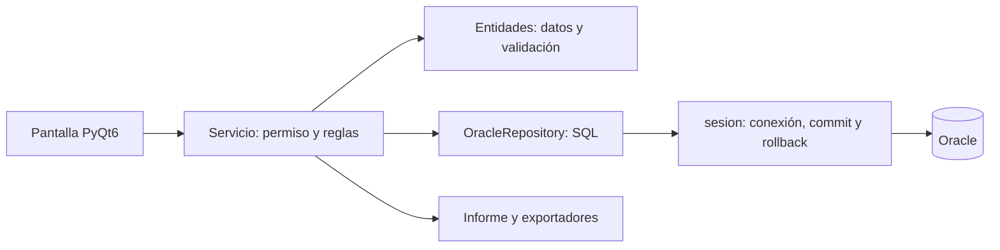

# Arquitectura de la entrega v1.1

La aplicación tiene cuatro pasos fáciles de seguir:

`VentanaLogin` obtiene una `CuentaUsuario` autenticada. Construye un
`GestionService` que conserva esa cuenta y el repositorio. Todas las pantallas
reciben el mismo servicio. Su atributo `es_admin` controla la presentación;
`autorizar` vuelve a comprobar el permiso antes de consultar o escribir.

Hay dos perfiles fijos. Se evitan tablas de permisos, tokens y gestores adicionales.
El cargo TipoEmpleado describe el trabajo; el rol de la cuenta determina el acceso.
ADMIN corresponde a RRHH, pero pertenecer a RRHH no crea una cuenta ni concede permisos.

`PantallaTabla` comparte tabla, formulario, botones y mensajes. Cada subclase
especifica sus campos y llama al servicio. No se duplican ventanas por rol.
`VentanaPrincipal` crea directamente las cinco pantallas comunes y agrega Cuentas
e Informes con un `if servicio.es_admin`. No hay pestañas provisionales ni un
administrador de carga diferida. El botón Actualizar vuelve a consultar los datos.
La contrapartida es que al entrar se realizan las consultas iniciales de todas las
pantallas permitidas.

Las entidades usan constructores explícitos, atributos con `_` y propiedades sin
setter. No se puede asignar normalmente un nuevo ID o autor del trabajo. Sus
métodos validan antes de modificar el estado. `_` es una convención de acceso
interno de Python; no proporciona privacidad criptográfica.

`Administrador` hereda Empleado y añade creación de empleados e informes. El
servicio usa esas operaciones después de verificar la cuenta. La herencia expresa
un subtipo de empleado; los permisos siguen siendo responsabilidad de la cuenta.

`OracleRepository` contiene las operaciones SQL de lectura y escritura. El servicio
incluye además las instrucciones de bloqueo y de lectura consistente que necesita
para coordinar una operación. Sus métodos reciben un
cursor que proporciona `transaccion`. Esto permite confirmar todas las consultas
y escrituras de una operación juntas. `database/connection.py` abre/cierra recursos;
el repositorio traduce errores Oracle a mensajes sin SQL ni credenciales.

Los IDs se generan con IDENTITY y se recuperan con RETURNING INTO. Las entidades
nuevas tienen ID None hasta insertarlas; el repositorio reconstruye las entidades
con el ID persistido en la lectura siguiente. Las relaciones se guardan por ID y
se protegen con claves foráneas. Consultar las adaptaciones al UML en UML_IMPLEMENTADO.md.

El cifrado se carga solo cuando se necesitan datos personales. No se crean claves
al importar módulos o iniciar sesión. Los campos personales se serializan como
JSON y se cifran en DATOS_CIFRADOS. Solo cargo y departamento quedan separados.
Esto evita cifrar cada campo con código repetido y conserva los tipos al leer.

La primera carga resuelve el ciclo departamento/gerente con FK diferidas. Inserta
un departamento con un gerente marcador 0, crea al gerente y actualiza la referencia
antes del commit. Nunca queda confirmado el marcador. También crea el empleado de
RRHH y su cuenta ADMIN dentro de la misma transacción.

Las horas bloquean la fila del empleado para comprobar el total diario y la del
proyecto para coordinar cambios de inicio. Desasignar usa el mismo bloqueo del
empleado. Las altas/ediciones de empleados bloquean departamentos para serializar
la comprobación de correo duplicado. Son bloqueos de Oracle, no hilos adicionales.
El informe lee las cuatro áreas en una transacción READ ONLY consistente.

El diseño se mantiene académico: lecturas sin paginación, validación de correo tras
descifrar y consultas síncronas. Para una empresa con muchos empleados se evaluarían
consultas específicas, índices y ejecución fuera del hilo visual; no se agregan a
esta entrega sin una necesidad demostrada.

La instalación lee .env y pide solo el primer acceso de EcoTech. La preparación
de la cuenta técnica Oracle queda como un paso del laboratorio; se retiraron la
creación de usuarios del servidor y la escritura automática de credenciales.

Los formularios principales acceden a propiedades y pasan parámetros explícitos.
Por ejemplo, guardar_proyecto recibe nombre, descripción, fecha e ID. Se conserva
PantallaTabla para reutilizar la presentación y los mensajes sin duplicar las
pantallas por rol.

-------------------------------------
CHAT

# Ambos roles usan las mismas clases de pantalla.
        titulo_empleados = 'Empleados' if servicio.es_admin else 'Mi ficha'
        titulo_proyectos = 'Proyectos' if servicio.es_admin else 'Mis proyectos'
        self.pestanas.addTab(VentanaEmpleados(servicio), titulo_empleados)
        self.pestanas.addTab(VentanaDepartamentos(servicio), 'Departamentos')
        self.pestanas.addTab(VentanaProyectos(servicio), titulo_proyectos)
        self.pestanas.addTab(VentanaAsignaciones(servicio), 'Asignaciones')
        self.pestanas.addTab(VentanaHoras(servicio), 'Horas')
        if servicio.es_admin:
            self.pestanas.addTab(VentanaCuentas(servicio), 'Cuentas')
            self.pestanas.addTab(VentanaInformes(servicio), 'Informes')
        accion = self.menuBar().addAction('Cerrar sesión')
        accion.triggered.connect(self.cerrar_sesion)

12:57 PM

Fíjate en esta línea:
self.pestanas.addTab(VentanaProyectos(servicio), titulo_proyectos)
addTab() recibe dos cosas. VentanaProyectos(servicio) crea la pantalla que se verá dentro de la pestaña. titulo_proyectos es el texto que aparece en la pestaña. Según el rol, ese texto dice Proyectos o Mis proyectos, y ambos roles usan la misma clase VentanaProyectos.

Aquí aparecen dos ideas distintas de PyQt6. addTab() agrega una pantalla, mientras que .connect() enlaza una acción con el código que se ejecutará. Ya tienes un ejemplo de lo segundo al final del fragmento:
accion.triggered.connect(self.cerrar_sesion)
Cuando el usuario elige «Cerrar sesión», PyQt6 llama a self.cerrar_sesion. Por eso ahí escribes el nombre de la función sin paréntesis: se la pasas a Qt para que la llame cuando ocurra el evento.

Siguiente paso, solo lectura. Abre ecotech/ui/ventana_proyectos.py y busca una línea que contenga self.boton(. Pégame una de esas líneas. Vamos a ver cómo EcoTech ya crea sus botones antes de escribir el de Consultar clima.

    
12:57 PM

self.boton('Guardar nuevo o cambios', self.guardar, True)

1:02 PM

Esa línea crea el botón Guardar nuevo o cambios:
self.boton('Guardar nuevo o cambios', self.guardar, True)
- 'Guardar nuevo o cambios' es el texto que ves en la pantalla.
- self.guardar es el método que se ejecutará al pulsar el botón. Se pasa sin paréntesis para que se ejecute al hacer clic.
- True es el tercer argumento. Su significado lo define boton(), que es un método propio de EcoTech.
Tu siguiente paso es seguir esa llamada. En VS Code, mantén Ctrl y haz clic sobre boton, o coloca el cursor encima y presiona F12. Si el editor no salta a la definición, abre ecotech/ui/comun.py y busca def boton(.

Pégame la definición de boton(). Así veremos qué hace ese True y podremos decidir qué valor corresponde a Consultar clima según quién deba ver el botón.

    
1:02 PM

def boton(self, etiqueta, accion, solo_admin=False):
        # Conecta el clic con ejecutar(accion): la acción se llama al pulsar, no al crear el botón.
        # Ocultar un botón no concede ni revoca permisos; GestionService vuelve a comprobarlos.
        boton = QPushButton(etiqueta)
        boton.clicked.connect(lambda: self.ejecutar(accion))
        boton.setVisible(not solo_admin or self.servicio.es_admin)
        self.botones.addWidget(boton)
        return boton

1:03 PM

Ahí está la respuesta. El tercer argumento se llama solo_admin. Cuando pasas True, el botón solo se muestra al administrador. Si omites el argumento, toma el valor False y el botón se muestra a ambos roles. Para Consultar clima, tiene sentido que ambos roles lo vean, ya que ambos tienen acceso a su pestaña de proyectos.

Hagamos una primera prueba de clic. En VentanaProyectos, crea este método al mismo nivel de indentación que guardar:
    def consultar_clima(self):
        print("Se pulsó Consultar clima")
Luego, dentro de __init__, junto a la línea que agrega el botón Guardar nuevo o cambios, agrega:
        self.boton('Consultar clima', self.consultar_clima)
Cuando haces clic, boton() pasa tu método a self.ejecutar(accion), que lo llama. El print() es temporal y sirve para comprobar que el clic llega al método.

Abre EcoTech desde la terminal con python3 -m ecotech, inicia sesión y pulsa Consultar clima en la pestaña de proyectos. Busca el mensaje en la terminal desde donde abriste la aplicación. Cuando lo veas, el siguiente paso será leer qué proyecto seleccionaste.

    
1:03 PM

funciono, sigamos

1:07 PM

Ahora hagamos que el botón identifique el proyecto seleccionado. La tabla ya guarda la fila elegida en self.seleccionado. Puedes ver el mismo patrón en VentanaProyectos: busca el método rellenar() y fíjate en cómo obtiene el proyecto de la fila.

En tu método consultar_clima, reemplaza el print() temporal por esto:
    def consultar_clima(self):
        proyecto = self.seleccionado

        if proyecto is None:
            raise ValueError("Selecciona un proyecto de la tabla.")

        print("Proyecto seleccionado:", proyecto.nombre)
None indica que aún no hay proyecto seleccionado. En ese caso, raise ValueError(...) detiene este método y el self.ejecutar() que vimos antes se encarga de mostrar el mensaje. Si hay una fila seleccionada, proyecto.nombre lee el nombre del objeto Proyecto.

Prueba dos cosas. Al abrir la pestaña, pulsa el botón sin seleccionar una fila y verifica que aparece el aviso. Luego selecciona un proyecto, pulsa de nuevo y comprueba que su nombre aparece en la terminal. Con eso listo, veremos de dónde sacar la ciudad y el país que necesita la consulta de clima.

    
1:07 PM

estamos listos, siguiente 

1:10 PM

Ahora el botón ya sabe qué proyecto seleccionaste. Para consultar el clima, también necesita saber dónde se ejecuta. Como Proyecto actualmente guarda nombre, descripción y fecha de inicio, en este ejercicio vamos a pedir la ciudad en una ventana de PyQt6.

Primero, importa QInputDialog. Arriba en ventana_proyectos.py, junto a los otros imports, agrega:
from PyQt6.QtWidgets import QInputDialog
Luego, pide la ciudad. Dentro de consultar_clima(), conserva la comprobación de proyecto is None. Reemplaza el print() que usaste para probar por estas líneas, al mismo nivel de indentación que proyecto = self.seleccionado:
        ciudad, aceptado = QInputDialog.getText(
            self, "Consultar clima", f"Ciudad del proyecto {proyecto.nombre}:"
        )
        if not aceptado:
            return

        ciudad = ciudad.strip()
        if not ciudad:
            raise ValueError("Ingresa una ciudad.")

        print("Ciudad ingresada:", ciudad)
getText() devuelve dos valores. ciudad contiene lo que escribiste y aceptado indica si pulsaste Aceptar. Si pulsas Cancelar, return termina el método. Si aceptas, .strip() quita los espacios al principio y al final, de modo que un texto hecho solo de espacios cuenta como vacío.

Tu prueba: selecciona un proyecto y pulsa Consultar clima. Prueba escribir Santiago, aceptar con el campo vacío y cancelar. Deberías ver, respectivamente, la ciudad en la terminal, el aviso de validación y el cierre del diálogo. Después agregamos el país para distinguir ciudades con el mismo nombre.

    
1:10 PM

pero siento que eso no esta correcto, asi no esta configurado el proyecto para funcionar, ventana_proyectos.py nisiquiera importaPYQT6 sino que importa pantallatabla

1:13 PM

Worked for 15s

Tienes razón sobre el patrón de EcoTech. Revisé tu VentanaProyectos: hereda de PantallaTabla y reutiliza self.campo(), self.boton() y self.ejecutar(). Si seguimos ese diseño, el código que abre el diálogo puede quedar en comun.py, junto a los demás controles de PyQt6. VentanaProyectos decidiría cuándo pedir la ubicación.

Hay un detalle importante. self.campo() agrega el control al formulario de edición, y tu pantalla oculta ese formulario a los empleados. Si ponemos ahí la ciudad, ellos verían el botón Consultar clima pero no podrían ingresar la ubicación. Un diálogo al pulsar el botón permite que ambos roles hagan la consulta.

Hagamos solo un paso. Abre ecotech/ui/comun.py y busca def confirmar(self):. Fíjate en cómo ese método abre un cuadro de diálogo y devuelve el resultado a la pantalla que lo llama. Ese es el patrón que podemos reutilizar para pedir la ciudad. Por ahora, deja tu consultar_clima() tal como está.

    
1:13 PM

def confirmar(self):
        # Exige una selección y pregunta antes de borrar; devuelve True solo si el usuario acepta.
        if self.seleccionado is None:
            raise ValueError('Seleccione una fila de la tabla.')
        return QMessageBox.question(self, 'Confirmar eliminación',
                                    '¿Eliminar el registro seleccionado? Se respetarán sus referencias.',
                                    QMessageBox.StandardButton.Yes | QMessageBox.StandardButton.No) == QMessageBox.StandardButton.Yes

1:15 PM

En confirmar(), QMessageBox.question() abre el diálogo y devuelve el botón que se pulsó. La comparación con Yes convierte ese resultado en True o False.

Para pedir la ciudad, usaremos el mismo patrón de diálogo con QInputDialog.getText(). Este devuelve dos valores: el texto escrito y un booleano que indica si la persona pulsó Aceptar.

Tu paso ahora es preparar el método en comun.py. Añade QInputDialog al bloque existente from PyQt6.QtWidgets import .... Luego, dentro de PantallaTabla, al mismo nivel de indentación que confirmar(), agrega:
    def pedir_texto(self, titulo, mensaje):
        return QInputDialog.getText(self, titulo, mensaje)
self hace que el diálogo se abra asociado a la pantalla que lo solicita. titulo y mensaje serán los textos que esa pantalla le pase. El método devuelve ambos valores para que la pantalla pueda distinguir Cancelar de Aceptar con el campo vacío.

Guarda comun.py. En el siguiente paso llamaremos a pedir_texto() desde consultar_clima() y veremos cómo recoger esos dos valores.

    
1:15 PM

Work locallyLocal
