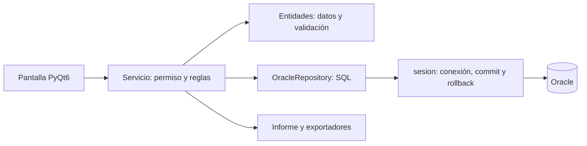

# Arquitectura de la entrega v1.1

La aplicación tiene cuatro pasos fáciles de seguir:

`VentanaLogin` obtiene una `CuentaUsuario` autenticada. Construye un
`GestionService` que conserva esa cuenta y el repositorio. Todas las pantallas
reciben el mismo servicio. Su atributo `es_admin` controla la presentación;
`autorizar` vuelve a comprobar el permiso antes de consultar o escribir.

Hay dos perfiles fijos. Se evitan tablas de permisos, tokens y gestores adicionales.
El cargo TipoEmpleado describe el trabajo; el rol de la cuenta determina el acceso.
ADMIN corresponde a RRHH, pero pertenecer a RRHH no crea una cuenta ni concede permisos.

`PantallaTabla` comparte tabla, formulario, botones y mensajes. Cada subclase
especifica sus campos y llama al servicio. No se duplican ventanas por rol.
`VentanaPrincipal` crea directamente las cinco pantallas comunes y agrega Cuentas
e Informes con un `if servicio.es_admin`. No hay pestañas provisionales ni un
administrador de carga diferida. El botón Actualizar vuelve a consultar los datos.
La contrapartida es que al entrar se realizan las consultas iniciales de todas las
pantallas permitidas.

Las entidades usan constructores explícitos, atributos con `_` y propiedades sin
setter. No se puede asignar normalmente un nuevo ID o autor del trabajo. Sus
métodos validan antes de modificar el estado. `_` es una convención de acceso
interno de Python; no proporciona privacidad criptográfica.

`Administrador` hereda Empleado y añade creación de empleados e informes. El
servicio usa esas operaciones después de verificar la cuenta. La herencia expresa
un subtipo de empleado; los permisos siguen siendo responsabilidad de la cuenta.

`OracleRepository` contiene las operaciones SQL de lectura y escritura. El servicio
incluye además las instrucciones de bloqueo y de lectura consistente que necesita
para coordinar una operación. Sus métodos reciben un
cursor que proporciona `transaccion`. Esto permite confirmar todas las consultas
y escrituras de una operación juntas. `database/connection.py` abre/cierra recursos;
el repositorio traduce errores Oracle a mensajes sin SQL ni credenciales.

Los IDs se generan con IDENTITY y se recuperan con RETURNING INTO. Las entidades
nuevas tienen ID None hasta insertarlas; el repositorio reconstruye las entidades
con el ID persistido en la lectura siguiente. Las relaciones se guardan por ID y
se protegen con claves foráneas. Consultar las adaptaciones al UML en UML_IMPLEMENTADO.md.

El cifrado se carga solo cuando se necesitan datos personales. No se crean claves
al importar módulos o iniciar sesión. Los campos personales se serializan como
JSON y se cifran en DATOS_CIFRADOS. Solo cargo y departamento quedan separados.
Esto evita cifrar cada campo con código repetido y conserva los tipos al leer.

La primera carga resuelve el ciclo departamento/gerente con FK diferidas. Inserta
un departamento con un gerente marcador 0, crea al gerente y actualiza la referencia
antes del commit. Nunca queda confirmado el marcador. También crea el empleado de
RRHH y su cuenta ADMIN dentro de la misma transacción.

Las horas bloquean la fila del empleado para comprobar el total diario y la del
proyecto para coordinar cambios de inicio. Desasignar usa el mismo bloqueo del
empleado. Las altas/ediciones de empleados bloquean departamentos para serializar
la comprobación de correo duplicado. Son bloqueos de Oracle, no hilos adicionales.
El informe lee las cuatro áreas en una transacción READ ONLY consistente.

El diseño se mantiene académico: lecturas sin paginación, validación de correo tras
descifrar y consultas síncronas. Para una empresa con muchos empleados se evaluarían
consultas específicas, índices y ejecución fuera del hilo visual; no se agregan a
esta entrega sin una necesidad demostrada.

La instalación lee .env y pide solo el primer acceso de EcoTech. La preparación
de la cuenta técnica Oracle queda como un paso del laboratorio; se retiraron la
creación de usuarios del servidor y la escritura automática de credenciales.

Los formularios principales acceden a propiedades y pasan parámetros explícitos.
Por ejemplo, guardar_proyecto recibe nombre, descripción, fecha e ID. Se conserva
PantallaTabla para reutilizar la presentación y los mensajes sin duplicar las
pantallas por rol.
